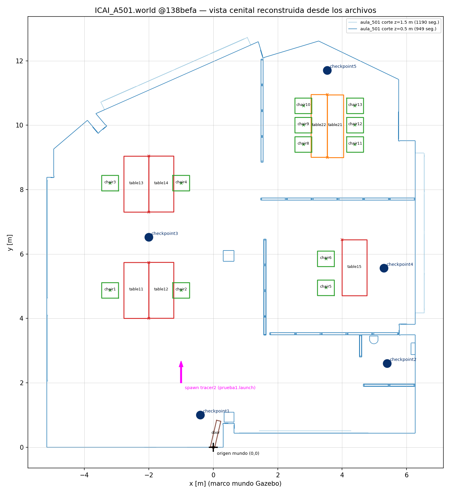

# RESUMEN F0 — Auditoría de repositorios SocialTech

**Estado:** ✅ CERRADA (2026-11-07, autorizada por José Ángel) · **Plan:** `../PLAN_MAPA_SOCIALTECH.md`
**Anexo con todo el detalle, pruebas y citas:** `evidencias/DETALLE F0.md`

## 1. Qué se ha auditado

| Repositorio / recurso | Commit analizado | Qué es |
| --- | --- | --- |
| SocialTech-Gazebo (`master`) | `138befa` (2026-01-22) | Mundos, modelos, robot `tracer2`, launch y RViz (ROS 1 Noetic + Gazebo Classic) |
| SocialTech-NOVNC (`main`) | `4fb87f7` (2024-02-21) | Docker + escritorio web noVNC. Solo es el entorno de trabajo |
| SocialTech_ws (`main`) | `830ec8b` (2025-05-13) | Workspace catkin que agrupa los 3 submódulos |
| tracer_ros / ugv_sdk | `774ba0f` / `20d85ec` | Copias sin cambios del fabricante AgileX; solo sirven para el robot real |
| Imagen `javicensaez/acroba_core:1.0` | digest `54de7157…` | Ubuntu 20.04 + CUDA + escritorio web + ROS Noetic. Revisada sin descargarla |

Los repositorios están clonados en esta carpeta **sin modificar**.

## 2. Cómo era el escenario del año pasado (ICAI_A501, 2025)



- **Aula:** una sola malla `aula_501.obj` hecha en SketchUp (paredes y suelo), en metros, de unos 11,7 × 12,7 × 2,8 m. Es estática y la misma malla hace de colisión.
- **Muebles:** son modelos independientes (`table1`, `table2`, `chair`, `door`) que se añaden al mundo con `<include>`, un nombre y una posición escrita a mano. En total, 7 mesas y 12 sillas.
- **Puerta:** un hueco en la pared más el modelo `door`, colocado abierto.
- **Checkpoints:** 5 discos en el suelo de 0,125 m de radio, sin colisión.
- **Origen de coordenadas:** el (0,0) está en la puerta de entrada.
- **Mapa:** no existía mapa del aula. RViz solo mostraba el robot y el lidar, y el mapa se obtenía por SLAM (gmapping).
- **Arranque:** `roslaunch SocialTech-Gazebo prueba1.launch`, que abre Gazebo Classic y RViz 1 con el robot `tracer2`.
- **Otros mundos:** también existen los de 2023 y 2026 (Loyola). Usan muros de tipo caja del editor de edificios, y en Loyola las puertas son macizas.

## 3. Lo comprobado en este equipo (Ubuntu 24.04 nativo)

Ya estaban instalados ROS 2 Jazzy, Gazebo Harmonic (gz-sim 8.15), RViz2 y el servidor de mapas de Nav2. No he instalado nada.

| Prueba | Resultado |
| --- | --- |
| Cargar `ICAI_A501.world` en Gazebo Harmonic (solo servidor) | ✅ sin errores; aparecen los 26 modelos en sus posiciones; tiempo real ≈ 1,0 |
| Validar los modelos del aula, mesas, silla, puerta y checkpoint | ✅ válidos |
| Cargar `Simple_l.world` (Loyola) | ✅ sin errores |
| Validar `Simple.world` y `Loyola_Hospital.world` | ❌ inválidos: falta un modelo al que apuntan y llevan rutas absolutas de otro equipo |
| Ver el escenario en la interfaz gráfica, colisiones con el robot, rendimiento | 🔎 no comprobado |

## 4. Qué reutilizamos y qué cambiamos

**Reutilizable:**
- Los modelos de mesa, silla, puerta y checkpoint.
- La organización: un modelo base del espacio y cada objeto como modelo aparte.
- Las convenciones: metros y un origen documentado.

**Hay que adaptar (todo es ROS 1 o Gazebo Classic):**
- El paquete catkin pasa a ament.
- Los `.launch` pasan a `launch.py` con `ros_gz_sim`.
- La configuración de RViz pasa a RViz2, ahora con el mapa.
- Los plugins del robot (para F5).
- Los materiales de los muros de Loyola.

**Se descarta:**
- Los scripts de obstáculos aleatorios y móviles.
- El entorno Docker/noVNC.
- tracer_ros y ugv_sdk, que solo se mirarán en F5.

## 5. Decisiones del responsable

1. **Todo se genera desde un plano 2D, nada a mano.** En Gazebo se ve el escenario 3D normal; el plano solo es la entrada y no aparece en Gazebo.
2. **Hacerlo de la forma más limpia, guiándonos por ICAI_A501 (2025)** y mejorando lo que sea fácil sin complicarnos.
3. **Puertas como en ICAI_A501:** hueco en la pared y puerta abierta.
4. **El mapa 2D para RViz2 incluye paredes y todo el mobiliario, sillas incluidas.** Se genera desde la misma geometría y con el mismo origen que el mundo de Gazebo.
5. **Sin obstáculos aleatorios ni móviles.**
6. **Formato de los checkpoints:** aún no se sabe. Mientras tanto se puede reutilizar el disco de 2025.

## 6. Enfoque que sale de F0

```
plano 2D ──(herramienta open source, se elige en F1)──► modelo base: suelo + paredes + huecos de puerta
                                                     └► mapa .pgm + .yaml (misma geometría y origen)
mundo Gazebo = modelo base + muebles y puertas de 2025 (<include> con su posición) + luces
RViz2        = mapa + (robot Tracer en F5)
```

Mejoras sencillas frente a 2025:
- Los modelos con Z hacia arriba de origen, sin el giro que tenían las mallas.
- Colisión en forma de caja para la silla si el rendimiento lo pide (la malla actual tiene 155 000 caras).
- Un único `launch.py` que arranca todo.

## 7. Cierre y siguiente paso

- **F0 cerrada.** Ya se puede explicar cómo se componía y ejecutaba el escenario original, con evidencias.
- **Pendiente para fases posteriores:**
  - Ver el escenario en la interfaz gráfica y comprobar colisiones con el robot (F2/F4).
  - Formato de los checkpoints (F7).
  - Variante exacta del Tracer (F5).
- **Siguiente, F1:** comparar con pruebas reales herramientas open source que conviertan un plano 2D en el modelo de Gazebo y en el mapa de RViz2, con el mínimo código propio.

**Evidencias (`evidencias/`):**
- `DETALLE F0.md`
- `vista_cenital_icai_a501.png` y su script `.py`
- `gzsim_icai_a501_headless.log`
- `gz_model_list_icai_a501.txt`
- `docker_acroba_core_1.0_capas.txt`
