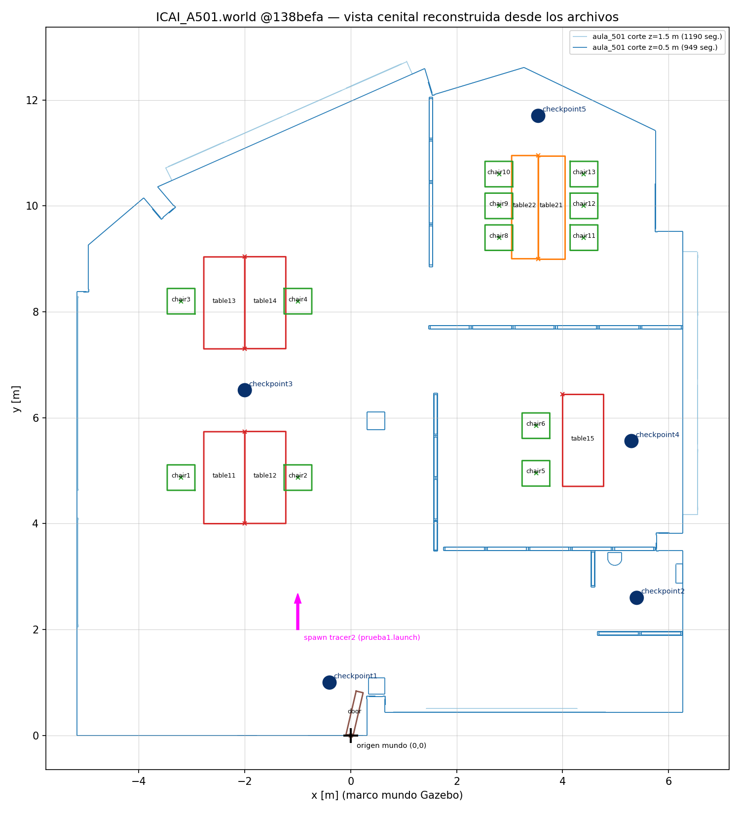

# F0 — Auditoría de los repositorios originales de SocialTech

> **Fecha:** 2026-11-07 · **Fase:** F0 — CERRADA (2026-11-07). Anexo detallado de `../RESUMEN F0.md` · **Plan de referencia:** `../../PLAN_MAPA_SOCIALTECH.md`
> **Leyenda de estado:** ✅ confirmado (comprobado) · 🔎 por comprobar · ❌ fallido · ➖ no aplicable
> Los repositorios clonados **no se han modificado** (`git status --porcelain` vacío en ambos al cierre).

---

## 1. Revisiones analizadas

| Repositorio | URL | Rama | Commit analizado (HEAD) | Fecha / autor | Nº commits |
| --- | --- | --- | --- | --- | --- |
| SocialTech-Gazebo | https://github.com/SocialTech-Challenge/SocialTech-Gazebo | `master` | `138befac04e04d0317d449a0a4edf08b765faab5` | 2026-01-22, *Manuel Eduardo* — "Update with new Loyola world" | 36 |
| SocialTech-NOVNC | https://github.com/SocialTech-Challenge/SocialTech-NOVNC | `main` | `4fb87f7d6192eab0f031d8cf78283a50bc0d2fb7` | 2024-02-21, *JaviVi* — "añadido ssh" | 11 |

Clones locales: `F0_AUDITORIA_REPOSITORIOS/SocialTech-Gazebo/` y `F0_AUDITORIA_REPOSITORIOS/SocialTech-NOVNC/`.

Repositorios relacionados (el Dockerfile de NOVNC los usa), **clonados y auditados tras la autorización del responsable**:

| Repositorio | Rama | Commit analizado (HEAD) | Fecha / autor | Nº commits | Fork de |
| --- | --- | --- | --- | --- | --- |
| https://github.com/SocialTech-Challenge/SocialTech_ws | `main` | `830ec8b2c2cdc7b2cf7a78a87eba5bbda206c920` | 2025-05-13, *JaviVi* | 17 | — |
| https://github.com/SocialTech-Challenge/tracer_ros | `master` | `774ba0f6e230501f36ffcb7a4051a2f0faf5328c` | 2021-09-02, *zhoups* | 24 | `agilexrobotics/tracer_ros` (0 commits propios, 3 por detrás) |
| https://github.com/SocialTech-Challenge/ugv_sdk | `main` | `20d85ec619a477a564e2e9f2c60004a854cc4ee5` | 2023-05-31, *Du Ruixiang* | 304 | `agilexrobotics/ugv_sdk` (0 commits propios, 39 por detrás) |

Imagen Docker base `javicensaez/acroba_core:1.0`: auditada por la API de Docker Hub (metadatos e historial de capas), **sin descargarla** (5,86 GB). Ver §4.5.

Submódulos fijados en `SocialTech_ws@830ec8b`: `src/SocialTech-Gazebo` → `c54e4f9` · `src/tracer_ros` → `774ba0f` · `src/ugv_sdk` → `20d85ec`.

> El submódulo fija SocialTech-Gazebo en `c54e4f9` (mayo 2025), pero el Dockerfile ejecuta `git submodule update --recursive --remote`, con lo que en la práctica se usaba la **última** revisión de cada submódulo en el momento de construir la imagen.

### 1.1 Historia relevante de SocialTech-Gazebo

| Época | Commits clave | Qué se hizo |
| --- | --- | --- |
| 2023-03 → 2023-10 (*JaviVi*) | `57a360a` inicial · `2edd435` "con navegacion" · `613774f` obstáculos fijos y móviles · `498f494`/`ba4e786` QR y cuadros | Robot `tracer2`, mundo `plano1.world` hecho con muros-caja, navegación con mapa (`maps/mymap.*`), obstáculos aleatorios por script, modelos `QR0..18` y `C0..18` (carteles con textura). |
| 2025-04 → 2025-05 (*diegocubillo*) | `33b4966` silla/mesas · `7b300f6` aula_501 y puerta · `06e280c` mundo ICAI_A501 · `29f7ac6` luces puntuales · `b28150f` **borrado de archivos no usados** · `cee4e43`/`7794b51`/`d927d37` checkpoints | Mundo `ICAI_A501.world` basado en una malla SketchUp del aula; se elimina `plano1.world`, QR, carteles, mapa y launch de pruebas 2 y 3. |
| 2026-01 (*Manuel Eduardo*) | `138befa` | Mundos hospitalarios `Simple.world`, `Simple_l.world`, `Loyola_Hospital.world`, modelos médicos de Gazebo Fuel y `launch/loyola_test.launch`. |

---

## 2. Inventario de formatos (SocialTech-Gazebo @138befa)

Recuento real de archivos (excluyendo `.git`):

| Extensión | Nº | Uso |
| --- | --- | --- |
| `.png` | 186 | Miniaturas Fuel (`thumbnails/`), texturas de mallas |
| `.obj` / `.mtl` | 43 / 43 | Mallas de modelos (aula, mobiliario, modelos Fuel); incluyen mallas `_Col` simplificadas en algunos modelos Fuel |
| `model.sdf` / `model.config` | 33 / 33 | Un par por cada uno de los 33 modelos de `models/` |
| `.jpg` | 27 | Texturas |
| `.STL` | 9 | Mallas del robot (`meshes/`) |
| `.xacro` / `.urdf` / `.gazebo` | 5 / 2 / 1 | Robot `tracer2` y obstáculos |
| `.world` | 4 | `ICAI_A501`, `Simple`, `Simple_l`, `Loyola_Hospital` |
| `.launch` | 2 | `prueba1.launch`, `loyola_test.launch` (ROS 1 XML) |
| `.rviz` | 1 | `rviz/model_display.rviz` (RViz de ROS 1) |
| `.py` | 2 | `scripts/ponerObstaculoFijo.py`, `scripts/moverObstaculo.py` (rospy) |
| `.dae` / `.tga` | 1 / 2 | Extintor (Collada) y texturas de ruedas |
| `package.xml`, `CMakeLists.txt` | 1 / 1 | Paquete **catkin** (ROS 1 Noetic) |

### 2.1 Existe / no existe

| Elemento pedido en el plan | Estado en @138befa |
| --- | --- |
| `worlds/` | ✅ existe (4 mundos) |
| `models/` | ✅ existe (33 modelos) |
| `meshes/` | ✅ existe, pero **solo contiene el robot** (9 STL) |
| `launch/` | ✅ existe (2 launch ROS 1) |
| `urdf/` | ✅ existe (robot + obstáculos) |
| `rviz/` | ✅ existe (1 archivo) |
| `worlds/ICAI_A501.world` | ✅ existe |
| `models/aula_501/model.sdf` | ✅ existe |
| `config/` | ❌ **no existe** (eliminado en `b28150f`), aunque `CMakeLists.txt:12` lo sigue listando en `install()` y `scripts/*.py` lo leen (`config/puntos.csv`, `config/puntosObstaculos.csv`) |
| `maps/` (mapa 2D `.pgm/.yaml`) | ❌ **no existe** en HEAD; existió `maps/mymap.{pgm,yaml}` hasta `b28150f` |
| Mapa 2D de ICAI_A501 o de Loyola | ❌ no existe en ninguna revisión |
| `launch/prueba2.launch`, `prueba3.launch` | ❌ eliminados en `b28150f` (el README de NOVNC aún los menciona) |
| Licencia propia | Solo `package.xml:11` declara `BSD`; no hay archivo LICENSE |

### 2.2 Modelos de `models/` y quién los usa

| Modelo(s) | Autor (`model.config`) | Malla | Usado por |
| --- | --- | --- | --- |
| `aula_501` | Diego Cubillo | `meshes/aula_501.obj` (5,4 MB, 41 420 vértices, 44 207 caras, 247 grupos, 57 materiales) + 19 texturas | `ICAI_A501.world` |
| `table1` ("Trapezoidal table") | Diego Cubillo | `mesa1.obj` | `ICAI_A501.world` |
| `table2` | Diego Cubillo | `mesa2.obj` | `ICAI_A501.world` |
| `chair` ("Four-legged chair") | Diego Cubillo | `silla.obj` (16 MB, 79 386 vértices, 155 001 caras) y además `Chair.obj` (Fuel, en cm) | `ICAI_A501.world` (silla.obj) y `Simple_l.world` (Chair.obj con `<scale>0.00817</scale>`) |
| `chair2` | — | **Duplicado exacto** de `chair` (`cmp` idéntico) y su `model.sdf` apunta a `model://chair/...`, no a sí mismo | Ningún mundo |
| `door` | Diego Cubillo | `door.obj` | `ICAI_A501.world` |
| `checkpoint` ("Circular checkpoint printed on the floor") | Diego Cubillo | **Sin malla**: cilindro r=0,125 m, h=0,0001 m, solo `<visual>` (sin colisión) | `ICAI_A501.world` |
| 25 modelos hospitalarios (anesthesiamachine, bedsidetable, … xraymachine, desk, fire extinguisher) | Open Robotics (Fuel) | Mallas locales **pero** sus `model.sdf` apuntan a **URLs remotas** `https://fuel.ignitionrobotics.org/...` o `fuel.gazebosim.org` | `Simple_l.world` (vía `model://`); `Simple.world` y `Loyola_Hospital.world` los llevan **embebidos** con URLs Fuel |

Texturas: las 25 referencias `map_Kd` de las MTL de aula, mesas, silla y puerta resuelven a archivos existentes ✅ (los `.mtl`/`.obj` del aula usan finales de línea CRLF).

---

## 3. Cómo se componía el escenario ICAI_A501 (sin conjeturas)

### 3.1 Cadena mundo → modelo → malla → pose → colisión

```
launch/prueba1.launch
 └─ world_name = worlds/ICAI_A501.world                 (prueba1.launch:2)
     ├─ <include> model://aula_501   pose implícita 0    (ICAI_A501.world:31-33)
     │    └─ models/aula_501/model.sdf  <static>true</static>
     │         ├─ <visual>    pose 0 0 0 1.570796327 0 0 → mesh model://aula_501/meshes/aula_501.obj
     │         └─ <collision> pose 0 0 0 1.570796327 0 0 → MISMA malla (trimesh completo)
     ├─ <include> model://door       pose 0 0 0 0 0 -1.8 (ICAI_A501.world:34-37)
     ├─ <include> checkpoint1..5     model://checkpoint, z = 0.01
     ├─ <include> table11..15        model://table1
     ├─ <include> table21..22        model://table2
     ├─ <include> chair1..6, 8..13   model://chair (chair7 comentada: "office owner's chair")
     └─ 30 <light type="point">      (sin <sun>, sin ground_plane)
```

- **Unidades:** metros. El OBJ lo declara (`aula_501.obj:3` → `# File units = meters`, exportado desde SketchUp).
- **Ejes:** las mallas OBJ están en **Y-arriba**; cada `model.sdf` lo corrige con `roll = +π/2` en `<visual>` y `<collision>`. Tras esa rotación:
  - `aula_501` ocupa **x ∈ [−5,179 ; 6,554] m, y ∈ [0 ; 12,736] m, z ∈ [0 ; 2,807] m** (≈ 11,7 × 12,7 m).
  - El **origen del mundo (0,0)** coincide con el hueco de la **puerta de entrada en la pared sur** del aula (ver figura).
- **Suelo:** la malla del aula **incluye el suelo** (718 triángulos a z≈0, 125 m²). Por eso el mundo no tiene `ground_plane`. **Techo:** no hay techo completo (solo 2,8 m² de superficies a z>2,79 m).
- **Colisión:** se usa la propia malla visual (malla de 83 677 triángulos tras triangular) como colisión; no hay geometría simplificada.
- **Iluminación:** 30 luces puntuales (`ICAI_A501.world:191-545`) en z=2,65–2,9 m, sustituyeron al sol en `29f7ac6`.

### 3.2 Orígenes locales de cada malla (medido, tras Rx(90°))

| Modelo | Bbox local (m) | Dónde está el origen del modelo |
| --- | --- | --- |
| `table1` (mesa1.obj) | x [0 ; 1,736] · y [0 ; 0,774] · z [0 ; 0,796] | **En una esquina** de la mesa, no en el centro |
| `table2` (mesa2.obj) | x [0 ; 0,502] · y [0 ; 1,948] · z [0 ; 0,739] | En una esquina |
| `chair` (silla.obj) | x [−0,24 ; 0,24] · y [−0,258 ; 0,265] · z [0 ; 0,838] | Centrado en planta, apoyado en el suelo |
| `door` (door.obj) | x [−0,84 ; 0] · y [−0,091 ; 0,044] · z [0 ; 2,02] | En la bisagra |
| `checkpoint` | cilindro r = 0,125 m | Centro |

Consecuencia práctica: la `pose` de una mesa en el mundo indica la posición de **una esquina**, y la orientación (`yaw ±π/2`) decide hacia dónde se extiende. Así se forman las "islas" de dos mesas `table11/table12` y `table13/table14`: comparten la esquina (−2, 4) / (−2, 7,3) y se giran en sentidos opuestos.

### 3.3 Cómo se colocaban paredes, mesas, sillas, obstáculos y checkpoints

| Elemento | ICAI_A501 (2025) | plano1.world (2023, eliminado) | Loyola / Simple (2026) |
| --- | --- | --- | --- |
| **Paredes** | Dentro de la **malla única** `aula_501.obj` (modelada en SketchUp), estática, colisión = malla | Modelo `plano1.world` con 14 links `Wall_N` (cajas 0,02 × L × 2,5 m), formato del *Building Editor* de Gazebo Classic | Modelo `Loyola` con 60 `Wall_N` (cajas 0,15 m de grosor × 2,5 m de alto) y 8 `Door_N` **macizas** (cajas 0,9 × 0,17–0,2 × 2 m), materiales `Gazebo/Grey` y `Gazebo/CeilingTiled` (scripts OGRE) |
| **Mesas/sillas** | `<include>` de modelos propios con `<name>`, `<static>true</static>` y `<pose>` escritos **a mano** | `<include>` de chair/table1/table2 apartados en x=20 (no en uso) | Modelos Fuel, posiciones con decimales tipo `-15.3882` y nombres `_clone_N` → **colocados con el ratón en la GUI** y guardados con "Save World" (presencia de `<state>`) |
| **Obstáculos** | No hay obstáculos de competición en el mundo | `urdf/obstaculo_fijo.urdf` (caja 0,4 × 0,4 × 1,2 m) **spawneada en tiempo de ejecución** por `scripts/ponerObstaculoFijo.py` en 3 de 10 posiciones aleatorias de `config/puntosObstaculos.csv`; obstáculo móvil por `scripts/moverObstaculo.py` siguiendo `config/puntos.csv` (2 732 puntos) con `/gazebo/set_model_state` | Mobiliario hospitalario estático/dinámico |
| **Checkpoints** | 5 discos `model://checkpoint` (r=0,125 m, z=0,01 m, solo visual, sin colisión) — commits `cee4e43`, `7794b51`, `d927d37` | Carteles `QR0..18` y `C0..18` en paredes (eliminados) | — |
| **Puerta** | Modelo `door` en (0,0), yaw −1,8 rad (abierta) | — | Cajas macizas `Door_N` |

Coordenadas exactas de ICAI_A501 (`worlds/ICAI_A501.world`):

| Nombre | Modelo | x | y | z | yaw | Línea |
| --- | --- | --- | --- | --- | --- | --- |
| checkpoint1 | checkpoint | −0,4 | 1 | 0,01 | 0 | 42 |
| checkpoint2 | checkpoint | 5,4 | 2,6 | 0,01 | 0 | 48 |
| checkpoint3 | checkpoint | −2 | 6,52 | 0,01 | 0 | 54 |
| checkpoint4 | checkpoint | 5,3 | 5,56 | 0,01 | 0 | 60 |
| checkpoint5 | checkpoint | 3,54 | 11,7 | 0,01 | 0 | 66 |
| table11 / 12 / 13 / 14 | table1 | −2 | 4 / 5,74 / 7,3 / 9,04 | 0 | +π/2 / −π/2 / +π/2 / −π/2 | 72–90 |
| table15 | table1 | 4 | 6,44 | 0 | −π/2 | 96 |
| table21 / 22 | table2 | 3,54 | 9 / 10,95 | 0 | 0 / π | 102–108 |
| chair1–4 | chair | −3,2 / −1 | 4,87 / 8,2 | 0 | ±π/2 | 114–132 |
| chair5, chair6 | chair | 3,5 | 4,95 / 5,85 | 0 | +π/2 | 138–144 |
| chair7 (comentada) | chair | 5,1 | 5,4 | 0 | −π/2 | 147–152 |
| chair8–13 | chair | 2,8 / 4,4 | 9,4 / 10 / 10,6 | 0 | ±π/2 | 157–187 |
| door | door | 0 | 0 | 0 | −1,8 | 36 |
| spawn robot `tracer2` | — | −1,0 | 2,0 | 0 | +π/2 | `prueba1.launch:3-6` |

### 3.4 Evidencia gráfica



`vista_cenital_icai_a501.png`, generada por `vista_cenital_icai_a501.py` (solo lectura del repo): cortes horizontales reales de la malla `aula_501` a z=0,5 m y z=1,5 m, huellas (bbox orientadas) de mesas/sillas/puerta aplicando las poses del mundo, checkpoints y spawn del robot. Se aprecian el contorno exterior, la fachada norte irregular, los despachos acristalados del lado este (x≈1,5 m; y 3,5–7,7 m) y que todo el mobiliario cae dentro de la planta.

---

## 4. Cómo se ejecutaba el sistema antiguo

### 4.1 Entorno (SocialTech-NOVNC @4fb87f7)

Pertenece al **entorno**, no a la geometría:

- `Dockerfile:1` parte de la imagen `javicensaez/acroba_core:1.0` (no auditada; se desconoce su contenido exacto 🔎). Instala paquetes **ROS 1 Noetic** (`ros-noetic-teleop-twist-keyboard`, `joint-state-publisher-gui`, `ros-controllers`, `gmapping`, `map-server`), SSH, y clona/compila `SocialTech_ws` con `catkin_make` (`Dockerfile:46-53`).
- `docker-compose.yml`: escritorio remoto por noVNC (puerto 6080, contraseña `mypasswd`), GPU NVIDIA obligatoria, volumen `./catkin_ws`.
- `supervisord.conf`: arranca entrypoint, pulseaudio, selkies-gstreamer y sshd.
- Nada de este repositorio contiene geometría de escenarios; **no es necesario para MAPA SOCIALTECH** salvo como documentación de flujo. Las credenciales en claro (`root:socialtech`, `PermitRootLogin yes`) no deben reutilizarse.

### 4.2 Arranque de la simulación (ROS 1)

`roslaunch SocialTech-Gazebo prueba1.launch` (o `loyola_test.launch` → `Simple_l.world`):

1. `gazebo_ros/empty_world.launch` con el `.world` (Gazebo Classic).
2. `xacro urdf/tracer2.xacro` → `robot_description`; `gazebo_ros/spawn_model` coloca `tracer2`.
3. `robot_state_publisher`, `joint_state_publisher`, TF estático `base_link → base_footprint`.
4. `rviz -d rviz/model_display.rviz`.
5. Teleoperación aparte con `teleop_twist_keyboard`.

Los modelos se resolvían por `package.xml:24` (`gazebo_model_path="${prefix}/models"`).

### 4.3 Qué mostraba RViz y cómo se obtenía el mapa

- `rviz/model_display.rviz`: displays **Grid, RobotModel, TF, LaserScan (`/scan`), Image (`/image_raw`)**; *Fixed Frame* = `base_link`. **No hay display de mapa** ni del mundo 3D.
- RViz **no** mostraba el `.world`; el mapa 2D se obtenía **por SLAM** (README NOVNC: `rosrun gmapping slam_gmapping`, luego `map_server map_saver`). El único mapa histórico, `maps/mymap.{pgm,yaml}` (eliminado en `b28150f`), era de `map_saver` con resolución 0,05 m, origen (−100, −100), 4000 × 4000 px.
- Por tanto: **mapa 2D, configuración RViz y modelo 3D eran artefactos independientes**, y el mapa no se derivaba de la geometría. Nuestro plan excluye SLAM, así que el mapa tendrá que generarse desde la geometría (F3).

### 4.4 Robot `tracer2` (solo para contexto de F5)

`urdf/tracer2.xacro` (exportado de SolidWorks), 9 STL en `meshes/`, diferencial (`wheelSeparation` 0,335 m, `wheelDiameter` 0,125 m), lidar 2D 720 muestras ±90° a 30 m en `rslidar_link`, cámara 640×480, IMU (`urdf/tracer2.gazebo`). Todo con plugins `libgazebo_ros_*` de Gazebo Classic. La variante real del Tracer queda pendiente para F5.

### 4.5 SocialTech_ws, tracer_ros, ugv_sdk e imagen Docker base

**SocialTech_ws @830ec8b** — solo es un *workspace* catkin contenedor:
- Contenido: `.catkin_workspace`, `README.md`, `.gitmodules` y `src/` con 3 submódulos + `src/CMakeLists.txt`, que es un **enlace simbólico a `/opt/ros/noetic/share/catkin/cmake/toplevel.cmake`** (solo válido dentro de un sistema Noetic).
- `README.md`: instalación de ROS Noetic en Ubuntu 20.04, `catkin_make`, configuración CAN-USB (`gs_usb`) para el Tracer **real** con `tracer_bringup`, y para simulación `roslaunch SocialTech-Gazebo prueba1.launch`.
- Historia: los commits solo actualizan el puntero del submódulo SocialTech-Gazebo (`4cac647` → `a9d7d03` → `eff22aa` → `ed15a08` → `34b2972` → `c54e4f9`). **No aporta geometría ni configuración propia.**

**tracer_ros @774ba0f** — copia **sin cambios** de `agilexrobotics/tracer_ros` (comparación GitHub: 0 commits por delante). Paquetes: `tracer_base` (nodo para el robot real vía `ugv_sdk`), `tracer_bringup`, `tracer_msgs`, `tracer_description` (URDF `tracer_v1.xacro` con mallas DAE/STL del fabricante), `tracer_gazebo_sim` (Gazebo Classic: `libgazebo_ros_control`, `libgazebo_ros_skid_steer_drive`, `libgazebo_ros_planar_move`; mundos `clearpath_playpen.world`, `weston_robot_empty.world`). Licencias en `package.xml`: BSD (y `TODO` en `tracer_description`).
- ✅ Comprobado con `grep`: **SocialTech-Gazebo no referencia ningún paquete de `tracer_ros` ni `ugv_sdk`**. La simulación del año pasado usaba su propio `tracer2.xacro`, no el modelo del fabricante.
- Para F5: existe `agilexrobotics/tracer_ros2` (rama `humble`, Apache-2.0, actividad en 2026-07). No probado en Jazzy 🔎.

**ugv_sdk @20d85ec** — copia **sin cambios** de `agilexrobotics/ugv_sdk` (Apache-2.0): biblioteca C++ de comunicación CAN/UART con robots AgileX (README: Ubuntu 18.04/20.04/22.04, ROS Melodic/Noetic/Foxy/Humble). Solo es necesaria para el **robot real**. ➖ No aplicable al mapa ni al escenario.

**Imagen `javicensaez/acroba_core:1.0`** (Docker Hub; actualizada 2022-07-10; amd64; digest `sha256:54de7157…6b86d`; 5,86 GB; 162 descargas). Historial de capas (`docker_acroba_core_1.0_capas.txt`):
- Base **NVIDIA CUDA 11.4.2 + cuDNN 8 sobre Ubuntu 20.04** (capas 00–61, 89).
- Escritorio remoto: LXDE, VirtualGL, selkies-gstreamer/noVNC, supervisord, PulseAudio (capas 62–105); variables `PASSWD=mypasswd`, `NOVNC_ENABLE=true`.
- `apt-get install -y ros-noetic-desktop-full` (capa 109, 710 MB) → incluye **Gazebo Classic 11** y RViz 1; herramientas catkin/rosdep/vcstool.
- Usuario `ubuntu`, `ENTRYPOINT /usr/bin/supervisord`; copia iconos de escritorio y configuración de Terminator.
- **Conclusión:** solo entorno (CUDA + escritorio web + ROS 1). No contiene modelos ni mundos. ➖ No se reutiliza: trabajamos en Ubuntu 24.04 nativo con Jazzy + Harmonic ya instalados.

---

## 5. Pruebas realizadas en este equipo (Ubuntu 24.04 nativo)

Entorno detectado (sin instalar nada): Ubuntu 24.04.5 LTS, `/opt/ros/jazzy`, `ros-jazzy-desktop 0.11.0`, `ros-jazzy-ros-gz 1.0.24`, **gz-sim 8.15.0 (Harmonic)**, libsdformat 14.9.0, `ros-jazzy-nav2-map-server` instalado. Docker 29.9.1 presente (no usado).

| Prueba | Comando (resumido) | Resultado |
| --- | --- | --- |
| Validación SDF de modelos aula_501, table1, table2, chair, door, checkpoint | `gz sdf -k model.sdf` | ✅ `Valid.` los 6 |
| Validación `Simple_l.world` | `GZ_SIM_RESOURCE_PATH=models gz sdf -k` | ✅ `Valid.` |
| Validación `ICAI_A501.world` | `gz sdf -k` | ➖ no concluyente: `gz sdf -k` no resuelve `model://` ("callback is empty"); es una limitación de la herramienta, no del mundo. Se verificó cargándolo en el simulador (fila siguiente). |
| **Carga de `ICAI_A501.world` en Gazebo Harmonic (servidor, sin GUI)** | `GZ_SIM_RESOURCE_PATH=$PWD/models gz sim -s -r --iterations 3000 -v 4 worlds/ICAI_A501.world` | ✅ rc=0, **ningún error ni warning**. `gz model --list` devuelve los **26 modelos** esperados (aula, puerta, 5 checkpoints, 7 mesas, 12 sillas). Pose de `table11` = (−2, 4, 0, yaw 1,5708) ✅. RTF ≈ 1,0 sin robot. Logs: `gzsim_icai_a501_headless.log`, `gz_model_list_icai_a501.txt` |
| Carga de `Simple_l.world` en Harmonic (servidor) | `gz sim -s -r --iterations 2000 -v 3` | ✅ rc=0, sin errores ni warnings en el log |
| Validación `Simple.world` y `Loyola_Hospital.world` | `gz sdf -k` | ❌ `Error Code 17: A model must have at least one link` + `Failed to load a world`. Causa probable: el modelo `Fire Extinguisher` contiene un `<frame ... attached_to='artifact_proximity_detector::'>` que referencia un modelo anidado inexistente, además de rutas absolutas `/home/ros1-me/.ignition/fuel/...` (líneas 5126, 5146, 5237, 5257 de `Simple.world`) |
| Disponibilidad de URLs Fuel usadas | `curl` a `fuel.ignitionrobotics.org` y `fuel.gazebosim.org` | ✅ HTTP 200 ambas (hoy) |

**No comprobado** 🔎: render visual en la GUI de Gazebo Harmonic (texturas/materiales OBJ, luces), colisiones del robot contra la malla del aula, rendimiento con el robot y sensores, comportamiento de los materiales OGRE (`Gazebo/Grey`, `CeilingTiled`) en Harmonic.

---

## 6. Reutilizable vs. requiere adaptación

### 6.1 Reutilizable (con evidencia de carga en Harmonic)

| Componente | Motivo | Estado |
| --- | --- | --- |
| Modelos `aula_501`, `table1`, `table2`, `chair`, `door`, `checkpoint` (`model.sdf` + `model.config` + OBJ/MTL/texturas) | SDF 1.7 válido para libsdformat 14; cargan en gz-sim 8 | ✅ carga · 🔎 render GUI |
| `worlds/ICAI_A501.world` | Solo usa `<include>` y luces; carga sin errores en Harmonic | ✅ carga · 🔎 render GUI |
| **Patrón de organización**: aula base como malla estática + objetos como modelos independientes incluidos con `<name>`/`<pose>`/`<static>` | Es exactamente la separación que pide F4/F7 | ✅ |
| Convenciones: metros, origen en la puerta, Z arriba en el mundo | Documentadas arriba | ✅ |
| Modelos Fuel hospitalarios | Licencias Open Robotics/Fuel; se pueden referenciar desde Fuel o localmente | 🔎 (no necesarios para el aula) |

### 6.2 Requiere adaptación a ROS 2 Jazzy / Gazebo Harmonic

Lo siguiente **no se ha probado**; se marca por ser API/paquetes de ROS 1 o Gazebo Classic que no existen en Jazzy/Harmonic tal cual:

| Componente original | Problema | Equivalente previsto (🔎 a verificar en fases posteriores) |
| --- | --- | --- |
| `package.xml`/`CMakeLists.txt` catkin | ROS 1 | `ament_cmake`; exportar `GZ_SIM_RESOURCE_PATH` (env-hook) en lugar de `gazebo_model_path` |
| `launch/*.launch` (`gazebo_ros/empty_world.launch`, `spawn_model`, `tf/static_transform_publisher`, `rostopic pub`) | ROS 1 + Gazebo Classic | Launch ROS 2 con `ros_gz_sim` (`gz_sim.launch.py`, `create`), `tf2_ros`, `ros_gz_bridge` |
| `rviz/model_display.rviz` | Clases `rviz/*` de ROS 1 | Nuevo `.rviz` para RViz2 (`rviz_default_plugins/*`) **con display Map** |
| Plugins `libgazebo_ros_diff_drive/laser/camera/imu_sensor.so` | Gazebo Classic | Sistemas gz-sim (DiffDrive, Sensors con `gpu_lidar`, Imu) + `ros_gz_bridge` — F5 |
| `scripts/*.py` (rospy, `/gazebo/spawn_urdf_model`, `/gazebo/set_model_state`) | ROS 1 / Classic; además dependen de `config/*.csv` que ya no existe | rclpy + servicios `ros_gz` / `gz service /world/<w>/create` — solo si F7 requiere obstáculos aleatorios |
| Materiales por script OGRE (`file://media/materials/scripts/gazebo.material`) en muros Loyola | Harmonic usa OGRE2; materiales por script de Classic no aplican | Colores `<ambient>/<diffuse>` (como ya hace `checkpoint`) |
| Plugin `ignition::gazebo::systems::PerformerDetector` (`libignition-...`) en Simple/Loyola | Nombre "ignition" antiguo + mundo inválido | Corregir o eliminar; no necesario para el aula |
| Colisión = malla visual completa (aula 83 677 triángulos; silla 155 001 caras, 16 MB, ×12 instancias) | Riesgo de rendimiento/estabilidad de contactos con el robot | Valorar colisiones simplificadas (cajas o malla `_Col`) — F4 🔎 |
| Mapa 2D | No existe para ICAI; el antiguo venía de SLAM | Generar desde la geometría (F1/F3) |

### 6.3 Defectos detectados en el original (no corregidos; solo documentados)

1. `models/chair2` duplica `chair` y su `model.sdf` se nombra `chair` y apunta a `model://chair/...`.
2. `models/table1/model.sdf:4` y `table2/model.sdf:4` tienen `<pose>0 0 0 1.5708 0 0</pose>` **a nivel de modelo**, además de la rotación en `<visual>`/`<collision>`. En ICAI la `<pose>` del `<include>` sobrescribe la del modelo (comprobado: roll=0 en `table11`), pero **si se incluyen sin `<pose>` quedarían giradas 180°**.
3. `models/chair/meshes/Chair.obj` (Fuel, en cm) convive con `silla.obj` en el mismo modelo.
4. `CMakeLists.txt:12` instala `config/`, que no existe → posible error de `catkin_make install` (🔎 no probado, ROS 1).
5. README de SocialTech-Gazebo indica `prueba1.launch` = escenario final pero ejecuta `loyola_test.launch`; README de NOVNC cita `prueba2.launch`, ya eliminado.
6. `Simple.world` / `Loyola_Hospital.world` no validan en libsdformat 14 y contienen rutas absolutas de otro usuario.
7. Muros `Door_N` del modelo Loyola son cajas macizas: las puertas están **cerradas** a efectos de colisión.
8. Las luces puntuales están a z=2,9 m, por encima de la altura máxima de la malla (2,807 m); no hay techo que las tape.

---

## 7. Estructura mínima equivalente que tendremos que entregar

Propuesta (a confirmar; respeta la organización de SocialTech-Gazebo y la adapta a ROS 2):

```
<paquete_ros2>/                 # ament_cmake
├── package.xml / CMakeLists.txt  (+ env-hook GZ_SIM_RESOURCE_PATH → share/<pkg>/models)
├── models/
│   ├── <espacio_base>/          # aula/vivienda/IQS: model.sdf + model.config + meshes/ (static, colisión)
│   └── <objetos>/               # mesa, silla, obstáculo, checkpoint… (uno por carpeta)
├── worlds/<escenario>.world|.sdf  # <include> del espacio base + objetos con <name>/<pose>/<static>, luces
├── maps/<escenario>.pgm + .yaml   # generado desde la MISMA geometría (F3), mismo marco que el mundo
├── rviz/<escenario>.rviz          # RViz2 con Map (+ RobotModel/TF/LaserScan en F5)
└── launch/<escenario>.launch.py   # ros_gz_sim + map_server (+ robot en F5)
```

Requisitos derivados: unidades en metros; Z arriba en el mundo; origen del mundo documentado y coincidente con el `origin` del `.yaml` del mapa; mallas OBJ (Harmonic las carga, comprobado con aula/mesas/sillas).

---

## 8. Decisiones del responsable (2026-11-07) y consecuencias

| # | Pregunta | Decisión de José Ángel | Consecuencia para el proyecto |
| --- | --- | --- | --- |
| 1 | ¿Estilo ICAI (malla única + objetos) o Loyola (muros-caja)? | "De la manera más limpia" | Ver §8.1. |
| 2 | Formato de checkpoints | **Aún no se sabe** | Se mantiene abierto para F7. Si no se indica otra cosa, el modelo `checkpoint` de 2025 (disco r=0,125 m sin colisión) es reutilizable tal cual. |
| 3 | ¿Obstáculos aleatorios o móviles? | **No hacen falta** | No se migran `scripts/*.py` ni `obstaculo_*.urdf`; los obstáculos serán modelos estáticos como el mobiliario. |
| 4 | Puertas | **"Tal cual el del año pasado"** (confirmado: ICAI_A501, 2025) | **Hueco en la pared + modelo `door` independiente colocado abierto** (yaw −1,8 rad), atravesable. No se usan las cajas macizas `Door_N` de Loyola (2026). |
| 5 | Auditar SocialTech_ws, tracer_ros, ugv_sdk | **Sí** | Hecho, §4.5. Ninguno aporta geometría; `tracer_ros`/`ugv_sdk` son copias sin cambios del fabricante, relevantes solo para F5. |
| 6 | Revisar imagen Docker base | **Sí** | Hecho, §4.5. Solo entorno ROS 1/CUDA/escritorio web; no se reutiliza. |
| 7 | ¿El mapa 2D incluye mobiliario? | **Sí, también el mobiliario** | El mapa de ocupación (F3/F4) se generará a partir de **paredes + mobiliario**, con la misma geometría y marco que el mundo Gazebo. |

### 8.1 Enfoque "más limpio", guiado por el año pasado y sin complicarnos

Se toma ICAI_A501 como referencia porque es el escenario que carga sin errores en Harmonic (§5) y el que tiene la organización más ordenada. Se cambia **solo lo necesario** para partir de un plano 2D:

| Aspecto | Año pasado (ICAI_A501, 2025) | Propuesta | Por qué |
| --- | --- | --- | --- |
| Espacio base | Malla SketchUp hecha a mano (visual = colisión, 83 677 triángulos) | **Modelo base generado desde el plano 2D**: suelo y paredes extruidas, con huecos de puerta. La herramienta concreta se elige en F1. | Es el objetivo del proyecto; se evita modelar a mano en SketchUp. |
| Organización | Aula base + objetos independientes con `<include>`, `<name>`, `<pose>`, `<static>` | **Igual** | Ya funciona y es limpio. |
| Unidades / ejes / origen | Metros; malla Y-arriba corregida con roll π/2; origen en la puerta | Metros; **Z-arriba nativo** (sin rotaciones); origen documentado y compartido por mundo y mapa | Evita el doble giro que tienen `table1`/`table2` (§6.3-2). |
| Puertas | Hueco + modelo `door` abierto | **Igual** | Decisión 4. |
| Mobiliario | Modelos OBJ propios (mesa, silla, puerta); colisión = malla visual | **Reutilizar los modelos de 2025**; si el rendimiento lo exige, colisión simplificada (caja) manteniendo la malla visual | Mejora sencilla (§6.2); la silla tiene 155 001 caras y se repite 12 veces. |
| Checkpoints | `model://checkpoint` | **Igual**, pendiente de confirmación (decisión 2) | — |
| Iluminación | 30 luces puntuales, sin sol ni `ground_plane` | Mantener el mismo criterio (suelo incluido en el modelo base); simplificar luces si no hace falta tanto detalle | — |
| Mapa 2D | No existía; se hacía por SLAM | **Generado desde la geometría** (paredes + mobiliario), `.pgm` + `.yaml` con `origin` coincidente con el mundo | Decisión 7; el plan excluye SLAM. |
| Arranque | `roslaunch` + Gazebo Classic + RViz 1 | Un `launch.py` con `ros_gz_sim` + `map_server` + RViz2 | Requisito de Jazzy/Harmonic. |

**Criterio para F1 derivado de lo anterior:** buscar herramientas *open source* que, a partir de un **plano 2D** (imagen u otro formato), produzcan **(a)** el modelo base de suelo y paredes para Gazebo y **(b)** el mapa de ocupación, o bien que produzcan uno de los dos y otra herramienta derive el otro **desde la misma geometría**. El mobiliario se añadirá como modelos independientes y se tendrá que reflejar también en el mapa. Esto descarta como prioridad las herramientas que solo hagan una de las dos cosas sin forma de mantener la coherencia.

### 8.2 Aclaraciones confirmadas (2026-11-07, segunda ronda)

- **El mundo de Gazebo se genera desde el plano 2D, no a mano.** En Gazebo se ve el escenario 3D normal (suelo, paredes, puertas y mobiliario). La imagen del plano **no** se muestra en Gazebo: solo sirve de entrada para generar el escenario.
- **Puertas:** confirmado que se toman como en **ICAI_A501 (2025)**: hueco en la pared + modelo `door` abierto.
- **Sillas en el mapa:** **sí**, por ahora el mapa 2D incluye todo el mobiliario, sillas incluidas. Se revisará si da problemas.

### 8.3 Dudas que siguen abiertas

1. Formato de los checkpoints de competición (decisión 2: aún no se sabe).

---

## 9. Resumen de cierre de F0

- **Hecho:** clonado de SocialTech-Gazebo, SocialTech-NOVNC, SocialTech_ws, tracer_ros y ugv_sdk (commits registrados), inventario completo de formatos, reconstrucción cuantitativa de ICAI_A501 (unidades, ejes, orígenes, poses, suelo, colisiones), análisis histórico (plano1, QR, mapa, obstáculos), análisis del entorno NOVNC y de la imagen Docker base, y registro de las decisiones del responsable (§8).
- **Verificado:** ICAI_A501 y Simple_l **cargan en Gazebo Harmonic (servidor) sin errores** con sus modelos; los 6 modelos del aula validan con libsdformat 14; Simple/Loyola_Hospital **fallan** la validación.
- **Pendiente:** render en GUI, colisiones con robot, rendimiento; dudas abiertas de §8.3.
- **Siguiente (requiere autorización):** F1 — investigación comparativa de herramientas de conversión plano 2D → SDF y de geometría → mapa 2D.

### Archivos de evidencia
- `vista_cenital_icai_a501.py` — script de reconstrucción (solo lectura; `python3 -I evidencias/vista_cenital_icai_a501.py SocialTech-Gazebo evidencias/vista_cenital_icai_a501.png`).
- `vista_cenital_icai_a501.png` — figura de §3.4.
- `gzsim_icai_a501_headless.log` — log de `gz sim -s -v 4` (3000 iteraciones, rc=0).
- `gz_model_list_icai_a501.txt` — salida de `gz model --list` con el mundo en ejecución.
- `docker_acroba_core_1.0_capas.txt` — historial de capas de la imagen base según la API de Docker Hub.
